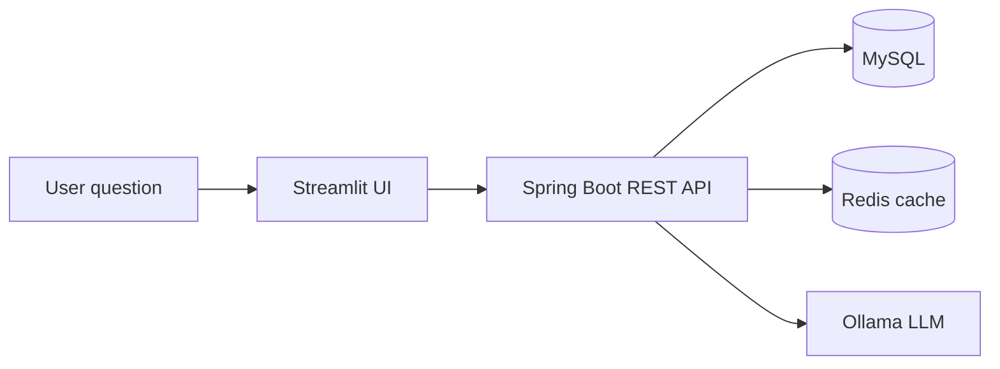
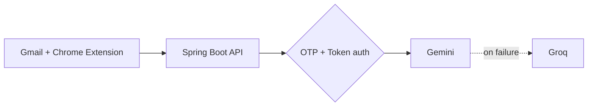

 

 

## 👋 Hi, I'm Bikash

I'm a Java developer who has **shipped 5+ applications**, from an AI-powered Gmail extension to a sales analytics platform. I build secure Spring Boot backends, plug in AI models where they add real value, and write code that stays clean as it scales.

|  |  |
|---|---|
| 🔭 **Building** | Secure REST backends and AI-integrated products |
| 🌱 **Learning** | Microservices, Kafka, Azure and CI/CD pipelines |
| 💼 **Open to** | Java Developer · Backend · Full-Stack roles (remote or on-site) |
| 📩 **Reach me** | bikashsah.dev@gmail.com |

---

## 🛠️ Tech Stack

<table>
<tr><td align="right"><b>Backend</b></td><td></td></tr>
<tr><td align="right"><b>Data and Cache</b></td><td></td></tr>
<tr><td align="right"><b>Messaging, Cloud, CI/CD</b></td><td></td></tr>
<tr><td align="right"><b>Frontend</b></td><td></td></tr>
<tr><td align="right"><b>Tools</b></td><td></td></tr>
</table>

Spring Security · JWT · OTP Auth · Microservices · JPA · Hibernate · JDBC · JUnit · SonarQube · Ollama · Gemini API · Groq API · Streamlit · Chrome Extensions

---

## 📌 Featured Projects

<table>
<tr>
<td width="50%" valign="top">

**📊 InsightIQ**: ask sales data questions in plain English, get charts and insights back. Spring Boot APIs, MySQL, Redis caching, local Ollama model, Streamlit UI.

</td>
<td width="50%" valign="top">

**✉️ QuickMail**: Chrome extension that writes and replies to emails inside Gmail. OTP login, token security, multi-provider AI fallback. [Extension repo](https://github.com/bikashcode-dev/quickmail-AI-frontend)

</td>
</tr>
<tr>
<td width="50%" valign="top">

**📄 ResumeFit**: compares a resume with a job description, extracts ATS keywords and gives a match score with fixes. PDF and DOCX support. [Live demo](https://roleforgeai.netlify.app/)

</td>
<td width="50%" valign="top">

**🎓 Acadify**: learning management backend with JWT role-based access for Admin, Instructor and Student, plus course lifecycle APIs.

</td>
</tr>
<tr>
<td width="50%" valign="top">

**🌐 Syncore**: social platform backend on MongoDB with posts, feed, follow/unfollow and interaction APIs.

</td>
<td width="50%" valign="top">

**🧠 Problem Solving DSA**: arrays, trees, graphs and dynamic programming in Java. Also: [Railway Booking](https://github.com/bikashcode-dev/Railway-Ticket-Booking-conasol-application) · [Bank Management](https://github.com/bikashcode-dev/bankManagemet-appl-backend)

</td>
</tr>
</table>

<b>🧩 How InsightIQ and QuickMail are put together</b>

 

---

## 📈 GitHub Activity

 

<picture>
  <source media="(prefers-color-scheme: dark)" srcset="https://raw.githubusercontent.com/bikashcode-dev/bikashcode-dev/output/github-snake-dark.svg" />
  <source media="(prefers-color-scheme: light)" srcset="https://raw.githubusercontent.com/bikashcode-dev/bikashcode-dev/output/github-snake.svg" />
  
</picture>

---

<i>Building real-world products and solving practical problems with clean, scalable code.</i>

