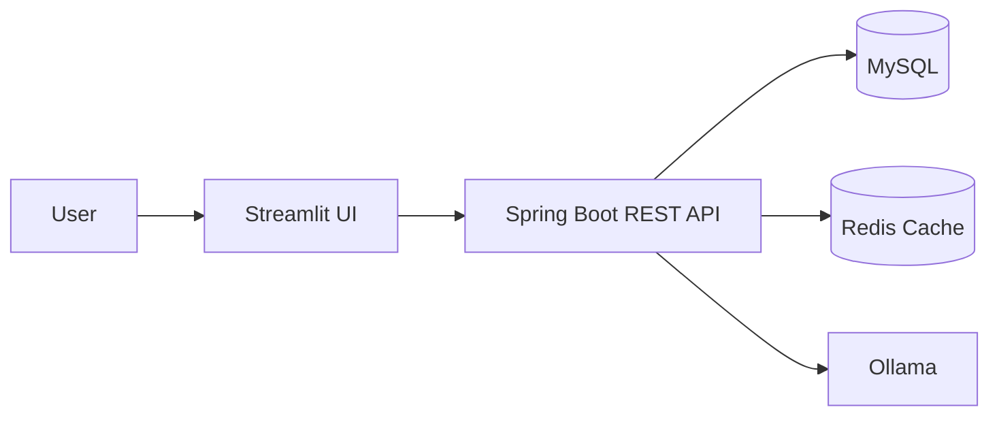
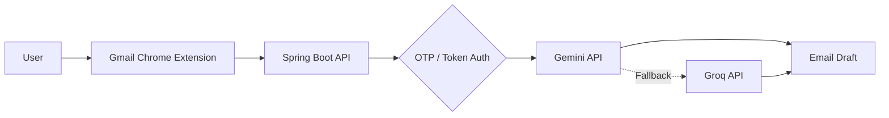

---

## Java Developer | Spring Boot & Backend Engineering

I build **Java and Spring Boot backends** with REST APIs, database integration, and authentication. My projects include AI-assisted email drafting, sales analytics, resume matching, and learning-management APIs.

- **Target roles:** Java Developer · Spring Boot Developer · Backend Developer
- **Availability:** Open to opportunities — **available for immediate joining**
- **Focus:** Clean API design, secure authentication, data access, and practical problem-solving

---

## 🛠️ Tech Stack

<table>
<tr><td align="right"><b>Backend</b></td><td></td></tr>
<tr><td align="right"><b>Data & Cache</b></td><td></td></tr>
<tr><td align="right"><b>Messaging & Delivery</b></td><td></td></tr>
<tr><td align="right"><b>Frontend</b></td><td></td></tr>
<tr><td align="right"><b>Tools</b></td><td></td></tr>
</table>

Spring Security · JWT · OTP Authentication · JPA · Hibernate · JDBC · JUnit · SonarQube · Chrome Extensions

### AI integrations — what they do

I connect AI models to applications through APIs or a local model runtime, so the app can do more than standard CRUD operations:

- **Gemini API + Groq API:** used in QuickMail's AI email-drafting workflow, with a fallback provider path.
- **Ollama:** runs a local language model for InsightIQ's natural-language sales-data workflow.
- **Streamlit:** provides the interactive interface for exploring InsightIQ results.

**Core backend focus:** Java · Spring Boot · REST APIs · MySQL · Redis · Authentication · Backend application design

---

## Featured Projects

<table>
<tr>
<td width="50%" valign="top">

### 📊 InsightIQ

**AI-assisted sales analytics**

Ask questions about sales data and explore insights through an analytics workflow.

- Spring Boot REST API
- MySQL data storage
- Redis caching
- Ollama integration and Streamlit interface

**Stack:** Java · Spring Boot · MySQL · Redis · Ollama

</td>
<td width="50%" valign="top">

### ✉️ QuickMail AI

**AI-assisted email productivity**

A Gmail-oriented Chrome extension for drafting and replying to emails with AI support.

- Spring Boot backend
- OTP login and token security
- AI provider integration and fallback
- Browser extension frontend

**Stack:** Java · Spring Boot · AI APIs · Chrome Extension

</td>
</tr>
<tr>
<td width="50%" valign="top">

### 📄 ResumeFit

**Resume and job-description matching**

A tool for comparing resumes with job descriptions and highlighting relevant keywords and potential improvements.

- Resume-to-role matching workflow
- ATS keyword analysis
- Match scoring and suggestions
- PDF and DOCX workflows

</td>
<td width="50%" valign="top">

### 🎓 Acadify

**Learning management backend**

Backend workflows for a learning-management application.

- Admin, Instructor and Student roles
- JWT-based access control
- Course lifecycle APIs

**Stack:** Java · Spring Boot · JWT · REST APIs

</td>
</tr>
<tr>
<td width="50%" valign="top">

### 🌐 Syncore

**Social application backend**

A project exploring social features such as posts, feeds, following, and user interactions.

</td>
<td width="50%" valign="top">

### 🧠 Java DSA

**Data structures & algorithms**

Practice with programming fundamentals and problem-solving using Java.

</td>
</tr>
</table>

### More projects

- [Railway Ticket Booking](https://github.com/bikashcode-dev/Railway-Ticket-Booking-conasol-application)
- [Bank Management Backend](https://github.com/bikashcode-dev/bankManagemet-appl-backend)

---

## How the applications fit together

<b>InsightIQ — analytics flow</b>

<b>QuickMail AI — email workflow</b>

---

## GitHub Activity

  

  

---

## Let's connect

**Interested in Java, Spring Boot, backend development, or AI-integrated applications?**

Building useful software, one commit at a time.

